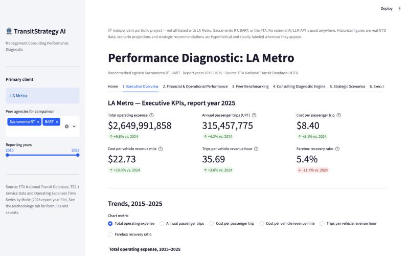
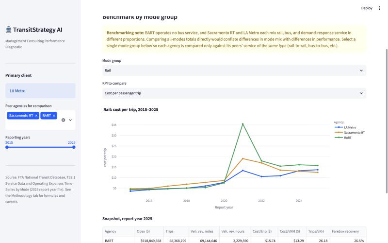
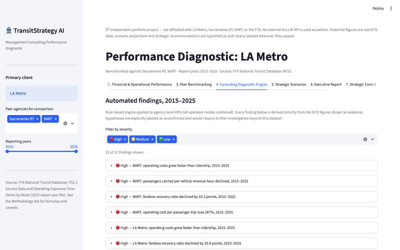
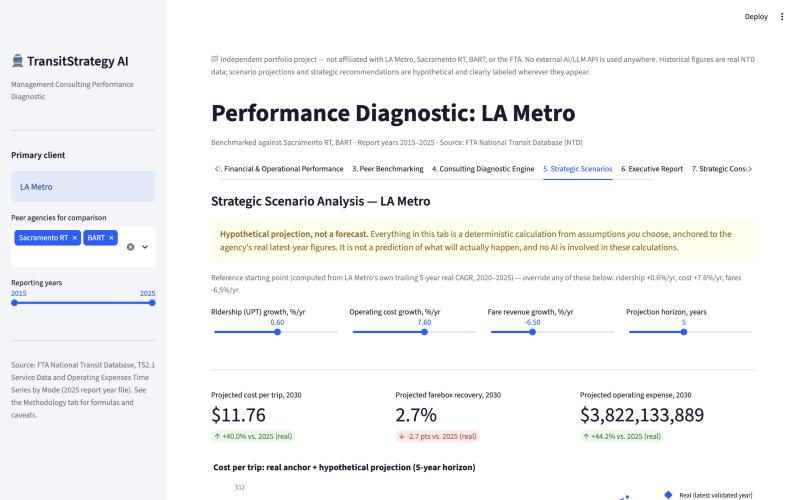
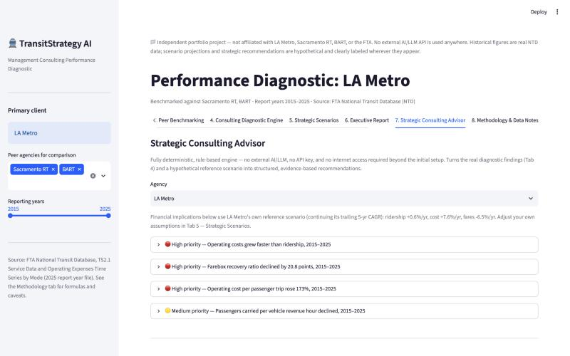

# 🚆 TransitStrategy Intelligence

**Turning Transit Data into Strategic Decisions.**

A management-consulting performance diagnostic for U.S. rail and public transportation agencies — built on real data from the Federal Transit Administration's National Transit Database (NTD).

> **Independent portfolio project.** Not affiliated with, endorsed by, or representing LA Metro, Sacramento Regional Transit, BART, the FTA, or any employer. Built to demonstrate data analysis, financial modeling, and application engineering. Uses **no external AI/LLM API** — every chart, finding, scenario, recommendation, and report download is a deterministic, fully offline calculation.

## Live demo

**[Link added at deployment]** — Streamlit Community Cloud. No account, install, upload, or API key required.

## Why this exists

Transit agencies across the U.S. are navigating a common challenge: operating costs have risen while ridership hasn't fully recovered from the pandemic-era decline, and farebox revenue covers a shrinking share of operating expense. TransitStrategy Intelligence demonstrates how a consulting-style performance diagnostic can be built entirely on public data — turning raw FTA filings into executive KPIs, peer benchmarks, evidence-based findings, hypothetical "what-if" scenarios, and a downloadable PowerPoint deck, with no proprietary data and no paid AI service.

**Default case study: LA Metro**, benchmarked against Sacramento Regional Transit and BART.

## Screenshots

| Executive Overview | Peer Benchmarking |
|---|---|
|  |  |

| Consulting Diagnostic Engine | Strategic Scenarios |
|---|---|
|  |  |

| Strategic Consulting Advisor |
|---|
|  |

## Features

- **Executive Overview** — KPI cards (total operating expense, ridership, cost per trip, cost per vehicle revenue mile, service productivity, farebox recovery) and 2015–2025 trend charts, with a reporting-year selector.
- **Financial & Operational Performance** — growth-index comparisons (cost vs. ridership, indexed to a common base year) and year-over-year change analysis.
- **Peer Benchmarking** — like-for-like comparisons restricted to a single transport mode (rail-to-rail, bus-to-bus), avoiding the trap of comparing agencies with very different mode mixes.
- **Consulting Diagnostic Engine** — a rule-based engine that flags significant trends (cost growth outpacing ridership, declining productivity, farebox recovery shifts, unusual year-over-year swings) directly from real data, every finding separating **evidence** from an explicitly labeled, unconfirmed **hypothesis**.
- **Strategic Scenarios** — a transparent, user-adjustable financial modeling tool. Pick ridership/cost/fare growth assumptions (pre-populated from the agency's own trailing CAGR) and see the projected impact — always labeled **"hypothetical projection, not a forecast."**
- **Executive Report Generator** — downloads a professional 8-slide PowerPoint deck (python-pptx) combining the real diagnostic, peer benchmarking, the scenario comparison, and the Strategic Consulting Advisor's recommendations and 90-day roadmap. Every slide is tagged **REAL DATA** or **HYPOTHETICAL**.
- **Strategic Consulting Advisor** — a fully deterministic, rule-based recommendation engine (no AI/LLM) that turns findings into structured recommendations: business problem, supporting data, strategic actions, hypothetical financial implications, implementation risks, and what additional information would be needed before treating any of it as a real decision.
- **Methodology & Data Notes** — every KPI formula, data-quality caveat, and source citation used anywhere in the app.

## Data sources

**FTA National Transit Database (NTD), TS2.1 — Service Data and Operating Expenses Time Series by Mode** (2025 report year file), covering 2015–2025, downloaded from [transit.dot.gov/ntd/ntd-data](https://www.transit.dot.gov/ntd/ntd-data). The workbook is committed to this repository (`data/raw/`) so the deployed app loads it automatically — no upload step. See [`reports/phase2_data_quality_report.md`](reports/phase2_data_quality_report.md) for the full source-data inspection (coverage, null-value analysis, agency identification).

NTD data is published by a U.S. federal agency; works of the U.S. federal government are generally not subject to copyright in the United States (17 U.S.C. §105). Reusers deploying this project publicly should independently confirm current FTA data-use terms before redistribution.

## Methodology

1. **Data processing** (`src/ntd_loader.py`, `src/kpi.py`) — loads the real NTD workbook and computes every KPI (cost per trip, cost per VRM, trips per VRH, farebox recovery, etc.) with no fabricated or interpolated values; a missing/zero denominator always yields `NaN`, never a silently invented number.
2. **Historical diagnostics** (`src/diagnostics.py`) — a rule-based engine that flags significant trends in the real data.
3. **Financial scenario modeling** (`src/scenarios.py`) — a deterministic, transparent "what-if" projection tool.
4. **Strategic Consulting Advisor** (`src/advisor.py`) — a deterministic, rule-based recommendation engine (no external AI/LLM).
5. **Executive Report Generator** (`src/report_generator.py`) — builds the PowerPoint deck from the same deterministic outputs as the rest of the app.

Full formulas and caveats are documented in the app's own Methodology tab and in [`ARCHITECTURE.md`](ARCHITECTURE.md).

## Project structure

```
TransitStrategy-AI/
├── app.py                      # Streamlit UI (no business logic)
├── src/
│   ├── ntd_loader.py            # Data processing: reads the raw NTD workbook
│   ├── kpi.py                   # Data processing: aggregation + KPI formulas
│   ├── diagnostics.py           # Rule-based historical findings
│   ├── scenarios.py             # Financial scenario modeling
│   ├── advisor.py               # Deterministic Strategic Consulting Advisor
│   └── report_generator.py      # Executive Report Generator (.pptx)
├── data/
│   ├── raw/                     # Real NTD workbook (committed)
│   └── processed/
├── reports/                     # Data-quality report + generated executive reports
├── tests/                       # One test file per src/ module (32 tests)
├── assets/screenshots/          # README screenshots
├── .streamlit/
│   └── config.toml              # Theme / server config (no secrets needed)
├── requirements.txt              # Pinned dependencies (no AI/LLM SDK)
├── runtime.txt                   # Python version pin
├── ARCHITECTURE.md
├── DEPLOYMENT.md
└── README.md
```

See [`ARCHITECTURE.md`](ARCHITECTURE.md) for the full module/data-flow design and [`DEPLOYMENT.md`](DEPLOYMENT.md) for the Streamlit Community Cloud deployment checklist.

> **Note on naming:** the product is now branded **TransitStrategy Intelligence**, and the
> planned public GitHub repository name is **`TransitStrategy-Intelligence`**. The local
> project folder above is still named `TransitStrategy-AI/` to avoid breaking existing file
> paths — it will be renamed on GitHub (or via a repo rename after the first push), not
> locally.

## Running locally

```bash
python3 -m venv .venv
source .venv/bin/activate
pip install -r requirements.txt
streamlit run app.py
```

Streamlit prints a local URL (typically `http://localhost:8501`). **No configuration, secrets, or API keys are needed** — every feature, including the PowerPoint report generator, works immediately, fully offline, once the data file and dependencies above are in place.

## Deploying

This app is built to deploy directly to **Streamlit Community Cloud** from the planned GitHub repository, **`TransitStrategy-Intelligence`**, with zero secrets to configure. See [`DEPLOYMENT.md`](DEPLOYMENT.md) for the full pre-flight checklist and go-live steps.

## Testing

```bash
source .venv/bin/activate
python3 -m pytest tests/ -v
```

32 tests across data processing, diagnostics, scenario modeling, the Strategic Consulting Advisor, and the PowerPoint report generator.

## Data policy

This project uses only real NTD data. No fictional or invented historical performance data is used anywhere in the application. Hypothetical scenario projections (Strategic Scenarios tab) and rule-based recommendations (Strategic Consulting Advisor tab) are visually and textually distinguished from real historical findings everywhere they appear. No external AI/LLM API is used to generate any content in this application.

## Status

- **Phase 1** — project scaffold, environment, homepage. Complete.
- **Phase 2** — real NTD dataset validated; data-quality report in `reports/phase2_data_quality_report.md`. Complete.
- **Phase 3** — performance diagnostic (Executive Overview, Financial & Operational Performance, Peer Benchmarking, Consulting Diagnostic Engine). Complete.
- **Phase 4** — Strategic Scenario Analysis, Executive Report Generator (PowerPoint), and the deterministic Strategic Consulting Advisor (no external AI). Complete.
- **Deployment** — architecture and checklist prepared in `DEPLOYMENT.md`; **not yet deployed** to Streamlit Community Cloud.
